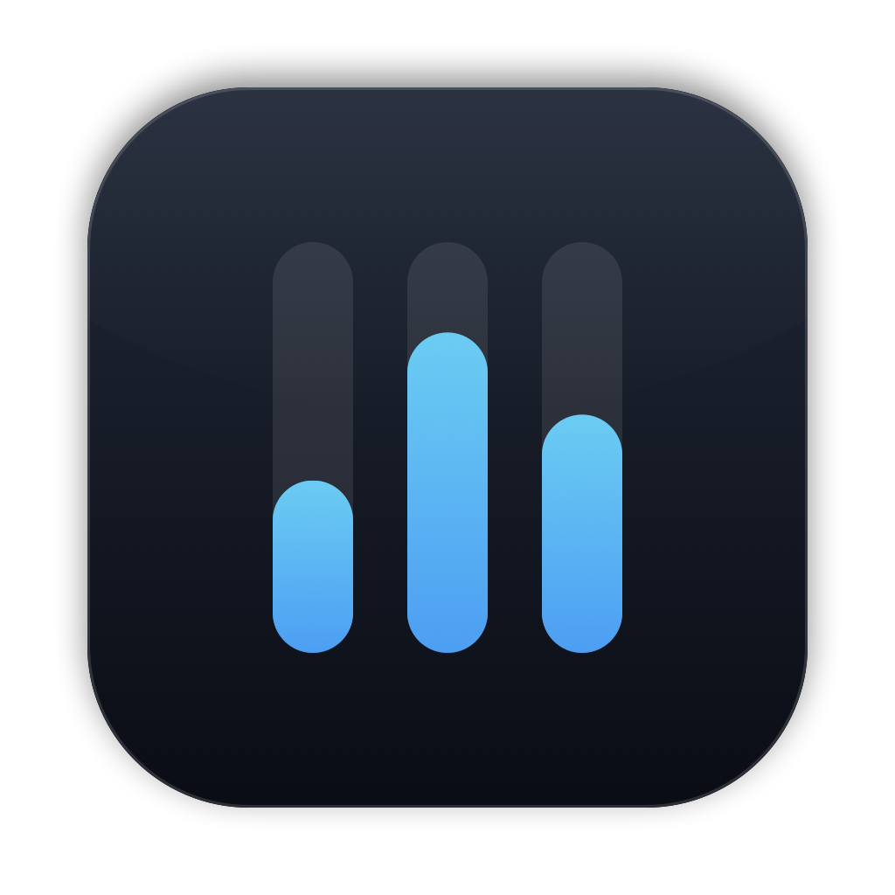
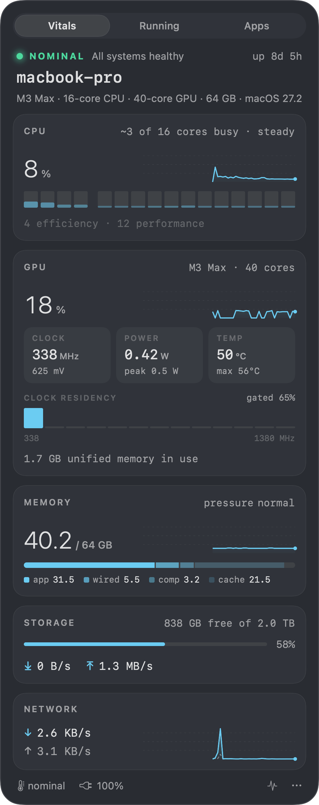
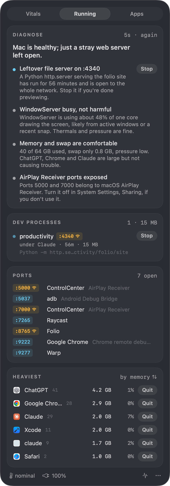
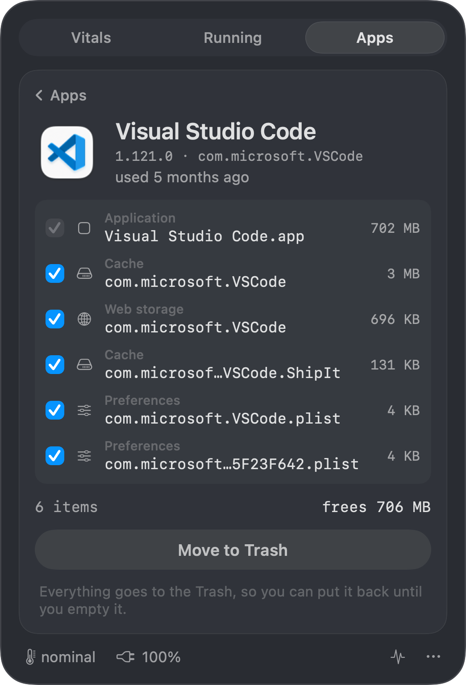

<p align="center">
  
</p>

<h1 align="center">Pulse</h1>

<p align="center"><b>Observability for a fleet of one.</b><br>
A quiet menu bar monitor for Apple Silicon Macs: CPU cores, GPU clocks and watts, memory pressure, disk and network.<br>
It also finds the dev servers you left running and uninstalls apps cleanly.</p>

<p align="center">
  <a href="https://yask.dev/pulse">Website</a> ·
  <a href="https://github.com/yask123/pulse/releases/latest">Download</a> ·
  <a href="#install">Install</a>
</p>

<p align="center">
  
</p>

## Install

```bash
brew install --cask yask123/tap/pulse
```

Or download `Pulse-x.y.z.zip` from [Releases](https://github.com/yask123/pulse/releases/latest), unzip, and move `Pulse.app` to `/Applications`.

> Pulse is ad-hoc signed, not notarized. Homebrew clears the quarantine flag for you. With a manual download, right-click `Pulse.app` → **Open** the first time, or run `xattr -dr com.apple.quarantine /Applications/Pulse.app`.

**Requires** macOS 26 or later on Apple Silicon.

## What it shows

The menu bar icon is three slim gauges (CPU, memory, disk). They're monochrome while things are healthy, and a gauge takes on amber or red when that resource is under strain.

Click it for the panel:

| | |
|---|---|
| **Health** | One status light with the reason: memory pressure, swapping, thermal throttling, disk nearly full. |
| **CPU** | Total load with two minutes of history, one bar per core (efficiency and performance cores set apart), and demand in plain words, e.g. “~3 of 16 cores busy · easing”. |
| **GPU** | Model and core count, utilisation, clock and voltage, power in watts, die temperature, and **DVFS clock residency**: how long the GPU spent at each frequency step, plus how often it was power-gated. |
| **Memory** | Used vs. total, a memory-pressure chart, and what RAM actually holds: app, wired, compressed, cache. |
| **Storage** | Free space and live read/write throughput. |
| **Network** | Download and upload on physical interfaces (VPN tunnels excluded so traffic isn't double-counted). |

Click any number for a one-line explanation of what it means.

### Running

<p align="center"></p>

| | |
|---|---|
| **Diagnose** | Asks Claude what's actually hurting the Mac, through your [Claude Code](https://claude.com/claude-code) login. A short verdict, with Stop or Quit on each finding. Only runs when you click. |
| **Dev processes** | Ruby, Python, Node, databases, headless browsers and the like, running outside any app, that hold a port, use real CPU or memory, or whose parent is gone. Orphaned ones are flagged in amber. Shows the project folder, port and age, with Stop. |
| **Ports** | Every other listening port and its owner. A Wi-Fi mark means it's open to your whole network. |
| **Heaviest** | Apps by memory or CPU, helper processes added together, with Quit. An app that won't quit gets Force Quit. |

### Apps

<p align="center"></p>

Every app you installed, with its size and when you last used it, sorted by size, by disuse, or by name. Uninstalling quits the app and anything running from inside it, then moves the app and the files it left in `~/Library` (caches, preferences, support files, web storage, launch agents) to the Trash. Leftovers matched by bundle identifier are selected; ones matched only by name are shown but not selected.

macOS protects other apps' sandbox containers. To remove those too, give Pulse **Full Disk Access**; otherwise Pulse points you to them in Finder.

## How it works

Everything runs in-process as your user. There's no root and no privileged helper. Pulse makes no network requests of its own; Diagnose hands a text snapshot (process names, CPU, memory, ports, command lines with anything secret-looking stripped) to the `claude` CLI, and only when you click it.

| Metric | Source |
|---|---|
| CPU per-core load | `host_processor_info` |
| Memory, compressor, swap, pressure | `host_statistics64`, `vm.swapusage`, `kern.memorystatus_*` |
| Disk throughput | IOKit `IOBlockStorageDriver` statistics |
| Network | `NET_RT_IFLIST2` 64-bit interface counters |
| GPU utilisation and memory | IOKit `IOAccelerator` performance statistics |
| GPU clock residency and power | IOReport (`GPU Stats`, `Energy Model`), the private framework behind `powermetrics`, loaded at runtime |
| GPU frequency and voltage table | `pmgr` device-tree `voltage-states9` |
| GPU temperature | AppleSMC `Tg*` sensors |
| Processes | `ps` for every process; `proc_pid_rusage`, `proc_pidfdinfo` and `KERN_PROCARGS2` for your own (footprint, listening sockets, working directory, arguments) |
| App last used | Spotlight `kMDItemLastUsedDate`, else the app's own preferences and support files |

IOReport and SMC aren't public APIs. If a future macOS moves them, those readouts show "—" and the rest keeps working.

Sampling runs every 2 seconds and costs about 0.1% of one core.

## Build from source

Needs Xcode 26+ command line tools.

```bash
git clone https://github.com/yask123/pulse && cd pulse
./build.sh --install        # build, copy to ~/Applications, launch
./build.sh --release 1.0.0  # versioned zip + sha256 for a release
```

`Tools/Snapshot.swift` renders the panel to PNG for design review:

```bash
swiftc -parse-as-library -D SNAPSHOT Sources/*.swift Tools/Snapshot.swift -o /tmp/snap
/tmp/snap docs                          # Vitals
/tmp/snap docs - running                # Running (runs a real diagnosis)
/tmp/snap docs - "apps:Visual Studio Code"   # an app's uninstall view
```

## License

MIT
